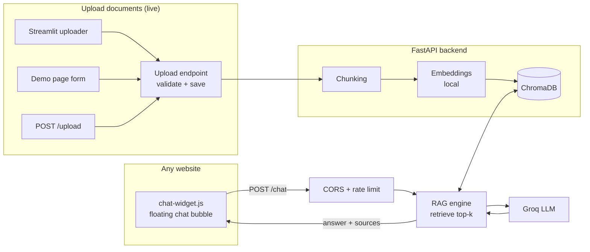

# web_chatbot_rag

**A generic RAG chatbot served as an API with a drop-in widget, so it can be added to any website with one line of code.**

Give it any documents and it answers visitor questions strictly from them. Change the documents, keep the pipeline.

## Architecture



Uploads are indexed immediately — there is no separate sync step. A bulk CLI
(`python src/ingest.py`) is still available for indexing a whole folder at once.

## Quick Start

```bash
pip install -r requirements.txt
cp .env.example .env          # add GROQ_API_KEY and describe your bot

uvicorn api:app --port 8000           # start the API
```

Try it: open `http://localhost:8000/static/index.html`.

Upload documents right on the demo page (or in the Streamlit app, or via
`POST /upload`) — the chatbot can answer questions about them immediately.
For bulk indexing from a folder instead: `python src/ingest.py`.

## Add It to Any Website

Paste this before `</body>`:

```html
<script src="https://YOUR-API-URL/static/chat-widget.js" defer></script>
```

Optional attributes: `data-title`, `data-welcome`, `data-color="#4f46e5"`, `data-position="left"`.

## API

| Endpoint                  | Description                                                            |
| ------------------------- | ---------------------------------------------------------------------- |
| `POST /chat`            | `{"message": "..."}` returns `{"answer": "...", "sources": [...]}` |
| `POST /upload`          | Multipart file upload (`.md` / `.txt` / `.pdf`, max `MAX_UPLOAD_MB`); indexes immediately, returns `{"filename": "...", "chunks": N}` |
| `GET /documents`        | Lists indexed documents with their chunk counts                        |
| `DELETE /documents/{filename}` | Removes a document from the index and deletes its uploaded file |
| `GET /config`           | Bot name and greeting used by the widget                               |
| `GET /health`           | Health check and chunk count                                           |

## Configure (`.env`)

| Variable                                                        | Purpose                                                                     |
| --------------------------------------------------------------- | --------------------------------------------------------------------------- |
| `GROQ_API_KEY`                                                | Required                                                                    |
| `BOT_NAME`, `BOT_SUBJECT`, `CONTACT`, `WELCOME_MESSAGE` | What the bot is about                                                       |
| `UPLOAD_DIR`                                                  | Where uploaded documents are stored (default `data/uploads`, relative to project root) |
| `MAX_UPLOAD_MB`                                               | Max upload size in MB (default `10`)                                        |
| `ALLOWED_ORIGINS`                                             | Sites allowed to call the API, e.g.`https://yoursite.com` (default `*`) |
| `RATE_LIMIT_PER_MIN`                                          | Requests per IP per minute (default 20)                                     |

## Deploy

```bash
docker build -t web-chatbot-rag .
docker run -p 8000:8000 --env-file .env web-chatbot-rag
```

The container serves the API, the demo page and the widget. Works on Render, Railway, AWS App Runner, or any Docker host. Use HTTPS in production, and set `ALLOWED_ORIGINS` to your site.

## Files

```
api.py            FastAPI backend
app.py            Streamlit frontend (chat + upload + knowledge base)
widget/           chat-widget.js + index.html (demo page)
src/              config, ingest, rag_engine
data/uploads/     documents uploaded through the website
Dockerfile
```
